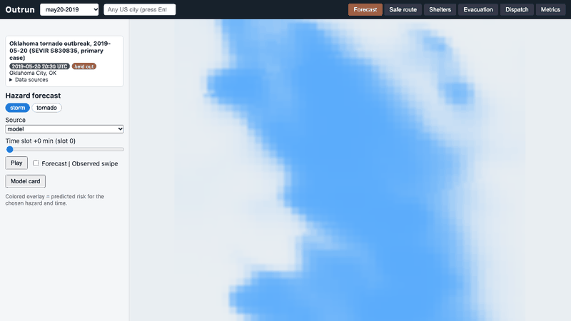

# Outrun

[](../../actions/workflows/tests.yml)


CMSC-5713 final project, due Dec 4 2026. Feature-frozen after T24; remaining work is the report, slides and demo video.

Outrun forecasts six weather hazards (severe storms, tornadoes, flash floods, wildfire spread, icy roads and
smoke) with deep-learning models trained on real weather, radar and satellite data, turns each forecast into a
calibrated risk map on one shared 1 km grid, and then plans on real OpenStreetMap roads: risk-aware evacuation
routes with a time-dependent A* search, capacity-constrained shelter assignments with min-cost flow, whole-city
evacuations with simulated annealing under congestion, and emergency-vehicle dispatch. Everything is shown in an
interactive map app that also runs fully offline.

> For my final project I propose Outrun, an AI system that uses deep learning and real weather, radar and satellite data to forecast severe storms, tornadoes, flash floods, wildfire spread, icy roads and smoke, then uses A* search and optimization on real road maps to plan safe evacuation routes, shelter assignments, whole-city evacuations and emergency vehicle routes, demonstrated through an interactive map app.
>
> (approved project proposal)

## Quickstart

```bash
make install        # Python 3.12 venv + pip install -e ".[dev]"
make test           # unit tests (synthetic data only, offline, no models or data needed)
make demo           # offline map app on the precomputed scenarios/ bundles
make e2e            # Playwright offline-demo test (python -m playwright install chromium once)
```

`scenarios/` is committed, so a clean clone runs the demo with no data, models or network. Live recomputation
(`make serve`) needs the data and trained models, which are not committed (see "Data location").



The GIF is captured from `outrun serve --demo` (`scripts/make_demo_gif.py`). The narrated video script is `DEMO.md`; the MP4 link is added here when the `v1.0-rc` release exists.

### Static demo (GitHub Pages)

`outrun export-static --out _site` writes a backend-free copy of the app (presets and metrics read from JSON and
PNG). `.github/workflows/pages.yml` builds it and deploys with the Pages actions. It is run by hand
(`workflow_dispatch`); this repo is not published.

## Results (one-shot held-out test, git sha 72d9715-dirty)

Full tables with 95% bootstrap CIs: `reports/metrics.md`. Per-model cards: `docs/model_cards/`.
Baselines win in several places, and they are listed as such.

| Hazard | Metric | Deep model | Best baseline | Verdict |
|---|---|---|---|---|
| Storm | CSI mean 74/133 | 0.533 | 0.467 (pySTEPS) | DL wins; IR adds nothing |
| Tornado | AUC TOR vs warned null | 0.761 | 0.762 (raw CNN) | Tie; calibrated is not better than raw. Published 0.874 not reached |
| Flood | AUPRC | 0.224 | 0.144 (logistic) | DL wins; FLASH adds nothing |
| Wildfire NDWS | PR-AUC | 0.357 | 0.153 (logistic) | DL wins; bootstrap is optimistic (per-sample) |
| Wildfire WSTS 2021 | PR-AUC | 0.372 | 0.456 (logistic) | **DL loses** |
| Ice | Zone AUPRC | 0.801 | 0.804 (logistic) | DL does not win |
| Smoke | RMSE, smoke episodes | 10.209 | 12.198 (HRRR cal.) | DL wins on RMSE; persistence has the better CSI (0.182 vs 0.114) |

**Routing** (plan on the forecast, score on observed risk; may20-2019, 500 origins): mean exposure in risk-minutes
a 5.90, a' 5.69, b 5.97, c 5.68, d 5.35. Planning on the DL forecast (c) closes 40.0% [17.6%, 56.1%] of the gap
between (a) and the oracle (d). Other scenarios: El Reno 16.7% [4.9%, 31.0%], flood 90.0% [32.8%, 121.8%],
ice -1.3% [-5.2%, -0.3%], smoke n/a (no risk). The tornado demo never blocks a road.

**Optimisation** (may20 metro, 5 seeds): SA 1892 vehicle-hours vs 9417 for shortest and 2962 for MSA, but MSA has
much lower exposure (814 vs 2779 veh-h) at the price of slower clearance (95 vs 33 min). SA's exposure is below
shortest and safest (both 3345); the two are nearly identical because congestion dominates the risk term there.
Shelter min-cost flow leaves 112,461 persons unserved in the
metro instance; nearest-shelter overflows 114,983. EMS: no blocked edges were hit, so no dispatch advantage is
shown (Hungarian ETA 4.15 min vs 3.97 min for reroute baseline). Latency: A* median 0.22 s, SA median 4.9 s.

**Acceptance:** 23 pass, 2 xfail (AC-09 tornado, ice), 1 skipped (AC-15, needs OSM and cache).

## Data location

Downloads (RAW) and processed data (PROC) live outside the repo. On the project Mac both are on the internal SSD:

```bash
export OUTRUN_RAW=/Users/milto/OutrunData/raw     # raw downloads, read once, never modified
export OUTRUN_PROC=/Users/milto/OutrunData/proc   # memmaps, zarr, parquet, graphs
```

Put these lines in `~/.zshrc` (or set them per command). Without them the code falls back to `/Volumes/OutrunRaw`
and `data/proc`. Disk caps are in `configs/disk.yaml`. The NDWS dataset comes from Kaggle and needs an API
token in `~/.kaggle/kaggle.json` (Kaggle -> Settings -> API -> Create New Token, then `chmod 600` the file).

## Docs

- `docs/DESIGN.md`: full design
- `specs/`: numbered, tested requirements (`specs/00-overview.md` has the proposal coverage matrix)
- `TASKS.md`: build order and progress
- `REPORT.md`: final report
- `docs/model_cards/`: one card per model
- `DATA_LICENSES.md`: data sources and licences

## License

Code: MIT (see `LICENSE`). Data: see `DATA_LICENSES.md`.
