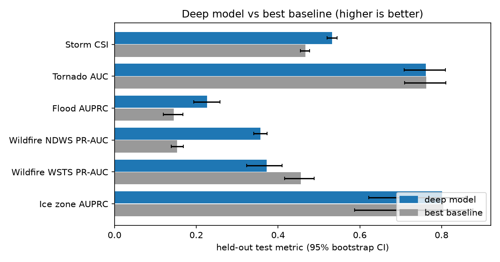
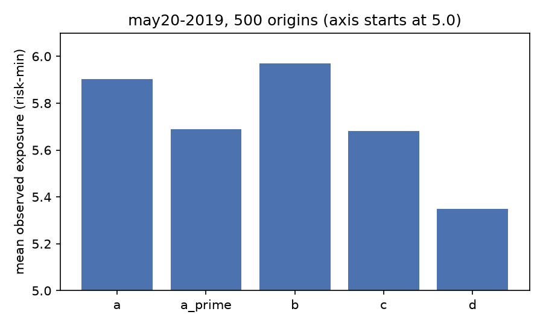
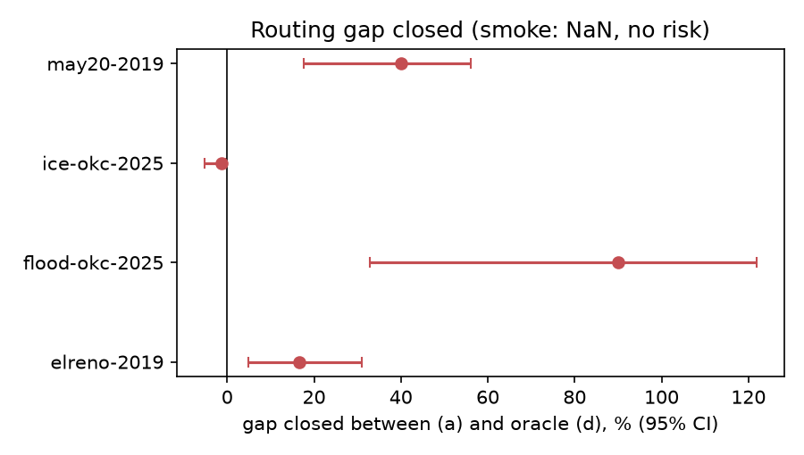
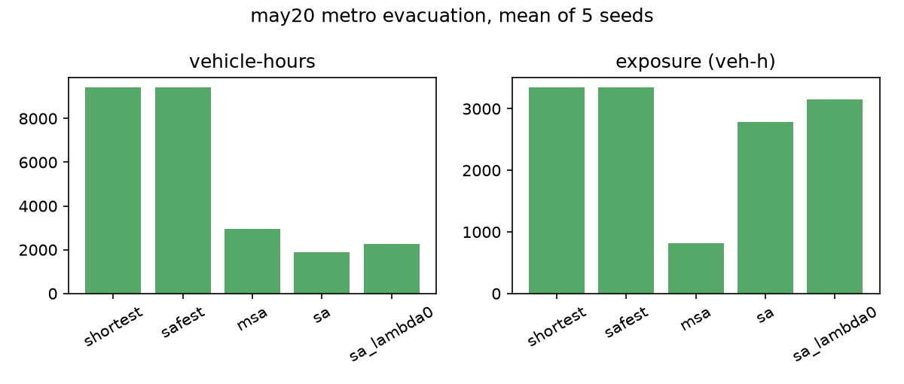

# Outrun: Report

CMSC-5713 final project. Every number below comes from `reports/metrics.md` and `reports/metrics/*.json`, the single
one-shot held-out evaluation (T24, git sha `72d9715-dirty`). Model selection and calibration used validation data only.
Intervals are 95% bootstrap CIs.

## 1. What I built and why

The approved proposal: an AI system that uses deep learning and real weather, radar and satellite data to forecast
severe storms, tornadoes, flash floods, wildfire spread, icy roads and smoke, then uses A* search and optimization on
real road maps to plan safe evacuation routes, shelter assignments, whole-city evacuations and emergency-vehicle
routes, shown in an interactive map app.

**Forecasting.** Six hazard models each produce a calibrated risk layer on one shared 1 km grid (EPSG:5070). All
layers share one `RiskLayer` / `RiskStack` / `HazardPolicy` interface, so the planners do not care which hazard they
are routing around. **Planning.** A custom time-dependent A* on real OpenStreetMap roads, OR-Tools min-cost flow for
shelter assignment, simulated annealing (SA) with BPR congestion for whole-metro evacuation (compared with MSA-UE,
shortest and safest-path baselines), and Hungarian dispatch for emergency vehicles. **App.** A FastAPI backend and a
vanilla MapLibre front end that runs fully offline from committed scenario bundles.

**Satellite inputs, named explicitly.**
- GOES-16 IR 10.7 um channel (IR107) from SEVIR, stacked with radar VIL as extra input channels of the storm U-Net.
- MODIS fire masks and VIIRS NDVI/bands inside the NDWS (Next Day Wildfire Spread) and WildfireSpreadTS (WSTS) datasets for the wildfire
  model; WSTS 2021 is used as an out-of-time test.
- NOAA HMS (Hazard Mapping System) satellite smoke polygons as an input to the smoke model.

Other data: radar (SEVIR VIL, TorNet), HRRR and MRMS/FLASH analyses, NCEI Storm Events and NWS zones for labels, AQS
PM2.5 for smoke targets, OpenStreetMap for roads. Licences are in `DATA_LICENSES.md`.

**Routing evaluation design.** Four planners: (a) plain shortest time, (a') risk-aware with the risk frozen at t0 (no forecast),
(b) risk-aware on the baseline-forecast layers, (c) risk-aware on the deep-model forecast, and (d) the oracle that plans
on the observed risk. All are scored on the observed risk, so the "gap closed" measures how much of the distance
between (a) and the oracle (d) the deep forecast recovers.

## 2. Technologies used and why (vs alternatives)

| Choice | Alternative considered | Why this won |
|---|---|---|
| PyTorch on Apple MPS, plain training loop | JAX-Metal, TF-macos, Lightning | Native on the M-series GPU; a short loop is easy to explain; the alternatives are experimental or hide the loop |
| 2D U-Nets/CNNs, time as channels | ConvLSTM, 3D conv, Earthformer | Every op is MPS-native, U-Net is the standard SEVIR baseline, transformers need more training time than available |
| pySTEPS extrapolation baseline | Persistence only | Persistence is too weak to prove anything; pySTEPS is the credible operational-style baseline |
| Own A* on numpy CSR graph (networkx as test oracle) | OSRM, GraphHopper, igraph | None accept time-varying hazard costs; A* is the algorithm the course covers |
| OR-Tools `SimpleMinCostFlow` | Hungarian only, MILP | Exact capacitated assignment in milliseconds; Hungarian is 1:1, a MILP is overkill |
| Own simulated annealing + BPR | Genetic algorithm, MATSim/SUMO | Transparent objective with incremental updates; MATSim/SUMO setup alone takes days |
| xarray + zarr, memmaps, Parquet | Raw HDF5/NetCDF/CSV | Zero-copy random access and labelled time dims; raw formats are slow or lock-prone under DataLoader workers |
| Herbie + cfgrib | Downloading whole HRRR files | `.idx` byte-range reads keep HRRR to the needed messages |
| FastAPI + SSE, vanilla MapLibre + PMTiles | React/Vite, Leaflet/folium, Mapbox | No build chain, works offline, animates flows, no token needed |
| pytest with a requirement-traceability layer, Playwright e2e | Ad hoc tests | Every spec requirement maps to a test; the offline demo is tested end to end |

## 3. Problems I faced and how I solved them (or didn't)

### 3.1 Forecast models versus baselines

| Hazard | Metric | Deep model | Best baseline | Verdict |
|---|---|---|---|---|
| Storm | CSI mean 74/133 | 0.533 [0.520, 0.544] | 0.467 [0.455, 0.477] (pySTEPS) | DL wins; case hold-out 0.563 vs 0.479 |
| Tornado | AUC TOR vs warned null | 0.761 [0.709, 0.810] | 0.762 [0.709, 0.811] (raw CNN) | Tie; published TorNet 0.874 not reached |
| Flood | AUPRC | 0.224 [0.191, 0.255] | 0.144 [0.119, 0.167] (logistic) | DL wins (raw U-Net 0.226) |
| Wildfire NDWS | PR-AUC | 0.357 [0.340, 0.373] | 0.153 [0.139, 0.168] (logistic) | DL wins; NDWS reference 0.284 |
| Wildfire WSTS 2021 | PR-AUC | 0.372 [0.323, 0.410] | 0.456 [0.416, 0.488] (logistic) | **DL loses** |
| Ice | Zone AUPRC | 0.801 [0.622, 0.858] | 0.804 [0.587, 0.876] (logistic) | DL does not win |
| Smoke | RMSE, smoke episodes (lower is better) | 10.209 [8.775, 11.951] | 12.198 [10.679, 13.913] (HRRR calibrated) | DL wins on RMSE; spatial hold-out 12.114 vs 13.670 |

Where the deep model did not win, stated plainly:

- **Tornado.** The calibrated CNN is no better than its own uncalibrated twin at ranking (0.761 vs 0.762). Calibration
  helps CSI (0.272 vs 0.208) and Brier (0.051 vs 0.075), not discrimination. My AUC is below the published TorNet 0.874.
  Reliability is also worse on the case hold-out (ECE 0.157). The gradient-boosting baseline reaches 0.648 and the
  delta-V rule 0.533.
- **Ice.** MIL-CNN zone AUPRC 0.801 vs logistic 0.804; the difference to logistic is -0.003 [-0.045, 0.077], i.e.
  indistinguishable. It does beat the physics rule (+0.210 [0.119, 0.326]) and climatology. With 121 day blocks the
  CIs are wide.
- **Wildfire WSTS.** On the out-of-time WSTS 2021 split the deep model (0.372) loses to pixel logistic (0.456) and
  even to plain persistence (0.433). The NDWS win does not transfer. The NDWS bootstrap resamples per sample, so
  those intervals are optimistic compared with the day-block intervals used elsewhere.
- **Smoke.** The model has the better RMSE, but persistence has the better CSI at the 35/4 threshold (0.182
  [0.163, 0.200] vs 0.114 [0.095, 0.132]) and much higher POD (0.308 vs 0.122). The model's 90% quantile coverage is
  0.911, near its nominal level.
- **Satellite ablations: IR and FLASH add nothing.** The VIL-only storm U-Net scores 0.536 [0.522, 0.548] against 0.533
  for VIL+IR; the no-FLASH flood U-Net scores 0.207 [0.175, 0.236] vs 0.224 (the raw variants are 0.210 vs 0.226), a
  difference within the intervals. The no-HMS smoke ablation gives 10.283 vs 10.209 RMSE (and 11.922 vs 12.114 on the
  spatial hold-out). The satellite channels did not measurably help any model here.

### 3.2 Routing: planning on the forecast, scored on what happened

| Scenario | (a) | (a') | (b) | (c) | (d) oracle | Gap closed (c) |
|---|---|---|---|---|---|---|
| may20-2019 (500 origins) | 5.903 | 5.689 | 5.969 | 5.681 | 5.349 | **40.0% [17.6%, 56.1%]** |
| elreno-2019 (100) | 3.146 | 2.920 | 3.133 | 2.920 | 1.793 | 16.7% [4.9%, 31.0%] |
| flood-okc-2025 (100, 95 paired) | 1.156 | 0.798 | 0.965 | 0.798 | 0.758 | 90.0% [32.8%, 121.8%] |
| ice-okc-2025 (100) | 7.850 | 7.856 | 8.250 | 7.856 | 7.362 | -1.3% [-5.2%, -0.3%] |
| smoke-okc-2024 (100) | 0.000 | 0.000 | 0.000 | 0.000 | 0.000 | n/a (NaN) |

(Mean observed exposure in risk-minutes.) The headline is may20-2019: planning on the deep forecast closes 40.0% of
the gap, and (c) beats (b) by -0.288 [-0.447, -0.137] risk-min. But this is one scenario, and the result is not
uniform. On ice the gap closed is about zero (slightly negative: a hair worse than shortest path), consistent with
the ice model not beating logistic. On smoke it is undefined because there is no routable risk at all, so every
planner scores 0. Flood's 90% has a CI that runs past 100% on 95 paired origins and 5 failed routes, so I treat it as
suggestive only. Against the frozen-at-t0 planner (a'), (c) is barely different on may20 (-0.008 [-0.023,
0.000]) and identical elsewhere, so most of the benefit on these scenarios comes from risk-aware planning itself,
not from the deep forecast specifically.

**The tornado demo never blocks a road.** The swath risk raises route cost, but no edge is closed (blocked crossings
are 0 for El Reno). The May 20 2019 tornado layer over the OKC box is empty (max p 0.000) and I did not track down
why. **The El Reno timing slack is demo-only:** TorNet El Reno chips end 03:27-03:45 UTC, after the storm forecast
time t0 of 03:00, so I used chips ending within 35 minutes of t0 (2 KTLX chips). That slack exists only to make the
demo scenario, and the El Reno case is held out of training.

### 3.3 Optimisation (may20 metro, 5 seeds)

| Method | Vehicle-hours | Exposure (veh-h) | Clearance (min) |
|---|---|---|---|
| shortest | 9416.5 | 3344.8 | 32.5 |
| safest | 9416.9 | 3344.8 | 32.5 |
| MSA-UE | 2962.0 | 814.1 | 94.8 |
| SA | 1891.8 | 2779.2 | 33.3 |
| SA (lambda 0) | 2273.0 | 3155.1 | 27.1 |

SA has the lowest vehicle-hours (1892 vs 9417 for shortest/safest and 2962 for MSA) and lower exposure than shortest
and safest (2779 vs 3345), clearing in about the same time (33 min). MSA has by far the lowest exposure (814) but pays
with slow clearance (95 min). Shortest and safest are nearly identical because congestion dominates the risk term.
Still unsolved: gaps to the lower bound (2414) remain large for every method (264% for SA).

Shelters: min-cost flow leaves 112,461 persons unserved in the metro instance (capacity-limited), and the nearest
shelter baseline overflows by 114,983, so the instance is infeasible in total and the comparison is about how the
shortfall is handled. Emergency vehicles: no dispatch hit a blocked edge, so no advantage is shown (Hungarian mean ETA
4.15 min vs 3.97 min for the reroute baseline). Latency: A* median 0.22 s (p95 0.33 s), SA median 4.9 s.

### 3.4 Engineering problems

- **Data volume.** Raw downloads reached 82 GB (SEVIR IR107 and VIL, TorNet, NDWS, OSM). I fetched only the
  STORMEVENTS subsets and fixed the fetch URLs after catching that the directory URLs would have pulled the random-event
  files too (about 166 GB).
- **Leakage and shortcuts.** Splits were frozen before any training, and each case-study date +-3 days is quarantined
  from train and val of every model. Official test splits are unmodified. The tornado AUC is reported against warned
  null chips, because separating tornadoes from quiet scenes alone is a radar-range shortcut; the range-only
  baseline (0.553) and gradient boosting document that.
- **Bugs caught.** The storm model's validation loss was 5x training loss from epoch 1, caused by the SEVIR VIL
  no-data fill value 255 being read as data.
- **Weak labels.** Ice and flood labels come from Storm Events reports, which are sparse and report-biased, so
  absolute scores are low (flood CSI at p50 is 0.035) and AUPRC is the more honest metric.
- **Exact time-dependent search.** Label-setting A* with FIFO-consistent edge costs; a label cap of 8 vs 64 gave
  identical exposure on 50 origins.
- **Offline demo.** Scenario bundles are committed so a clean clone runs `make demo` with no data, models or network.
- **Acceptance.** 23 pass, 2 expected failures (AC-09 for tornado and ice, where the target was not met and I recorded
  the real number rather than loosening it), and AC-15 is skipped because it needs OSM and cache data that are not in a
  clean clone. The suite had 1097 passed and 0 failed at T24.

## 4. What I learned

- Baselines are not a formality. Four of the six models lost or tied somewhere (tornado, ice, wildfire WSTS, smoke CSI), and the strongest baselines
  (logistic, uncalibrated twin, persistence) were competitive in exactly the data-poor or label-noisy problems.
- Evaluation design matters more than architecture: the warned-null AUC, day-block bootstraps, quarantined case days
  and one-shot test evaluation changed conclusions (the NDWS win versus the WSTS loss is the clearest example).
- A forecast improvement only matters if it moves a decision. Routing closed 40% of the gap in one storm and none on
  ice, and most of the gain came from using any risk at all.
- Calibration fixes probability quality (Brier, ECE, CSI at a fixed threshold), not ranking.
- Satellite channels sounded promising but measurably added nothing (IR, FLASH, HMS) at this data size.
- Writing the spec and tests first, with the AI assistant filling in code, made it possible to catch regressions, but it
  also means I had to review everything closely, since tests alone do not prove the science.

## 5. How I would improve it

- Tornado: understand the gap to the published 0.874 (training schedule, full TorNet resolution, no-range checkpoints)
  and fix the empty May 20 tornado layer; evaluate an actual road-blocking policy.
- Wildfire: retrain or fine-tune on WSTS-like out-of-time data, and use per-fire block bootstraps for NDWS.
- Ice and flood: better labels (road-sensor or gauge data) and more events, so differences of a few thousandths can be
  resolved; extend routing evaluation to many more scenarios than one primary case.
- Smoke: add a threshold-aware loss so the model competes with persistence on CSI, not just RMSE.
- Optimisation: close the large gap to the lower bound, and try a multi-objective formulation that keeps SA's
  clearance and MSA's low exposure; validate EMS on an event that actually blocks roads.
- Satellite: test finer or more channels before concluding that satellite data cannot help.

## Tools used

Specs, tests and much of the code were produced with AI assistance (Claude Code; local Qwen workers for some
mechanical tasks). Milton made the decisions and can explain every part.
